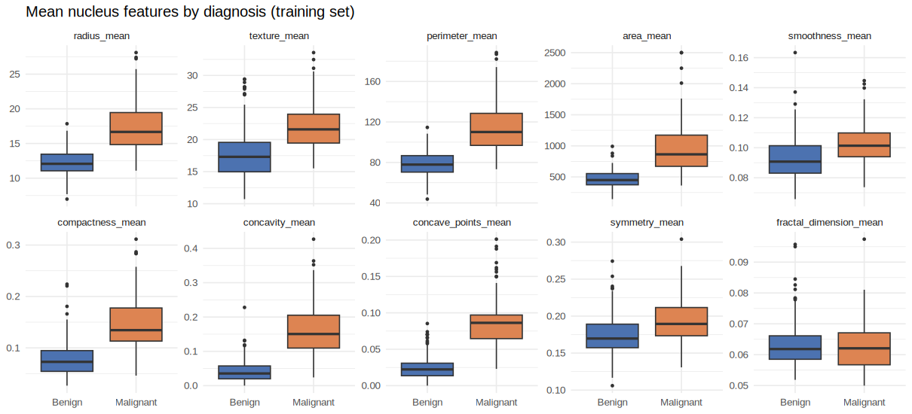
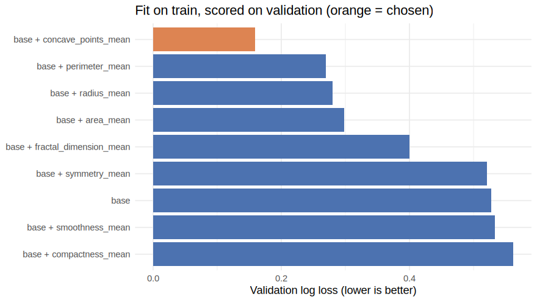
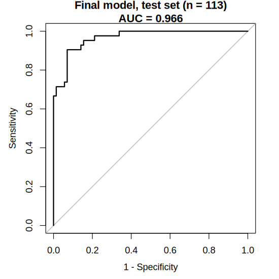
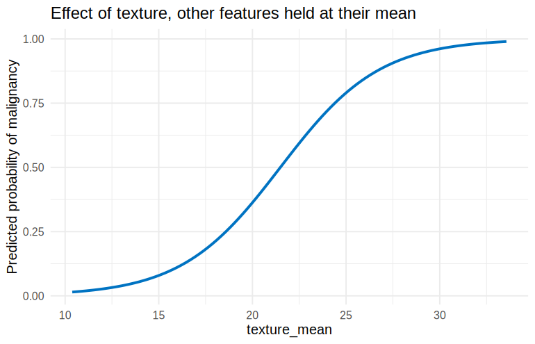

Breast Cancer Diagnosis with Logistic Regression (R)
================
Luke Wamalwa
2025-04-19 (revised 2026-10-27)

- [Load and split the data](#load-and-split-the-data)
- [Exploration (training set only)](#exploration-training-set-only)
- [Full model on the training set](#full-model-on-the-training-set)
- [Model selection on the validation
  set](#model-selection-on-the-validation-set)
- [Final model: refit on train + validation, evaluated once on the test
  set](#final-model-refit-on-train--validation-evaluated-once-on-the-test-set)
- [Interpreting the coefficients](#interpreting-the-coefficients)
- [Limitations](#limitations)

Can a small, interpretable logistic regression on the ten *mean*
cell-nucleus features of the Breast Cancer Wisconsin (Diagnostic) data
separate malignant from benign fine-needle aspirates?

This is the **R version** of the analysis. The Python version (same
data, same procedure) lives in
[breast-cancer-analysis-python](https://github.com/lukahere007/breast-cancer-analysis-python).

**Procedure (each split is used for one job only):**

1.  Stratified split: 60% train, 20% validation, 20% test.
2.  On **train only**: exploratory plots, a full 10-feature model, and
    screening for significant predictors.
3.  Candidate models (screened base + one extra feature) are fit on
    **train** and compared on **validation**.
4.  The chosen feature set is refit on train + validation and scored
    **once** on the **test** set.

## Load and split the data

`data/wdbc.csv` is the UCI Breast Cancer Wisconsin (Diagnostic) dataset
(569 aspirates, 30 features).

``` r
Cancer <- read.csv("data/wdbc.csv")
Cancer$diagnosis <- factor(Cancer$diagnosis, levels = c("B", "M"))   # M = malignant
cancer <- Cancer[, 2:12]                                              # diagnosis + 10 *_mean features
names(cancer) <- gsub("\\.", "_", names(cancer))                      # concave.points_mean -> concave_points_mean
table(cancer$diagnosis)
```

    ## 
    ##   B   M 
    ## 357 212

``` r
set.seed(123)
train_index <- createDataPartition(cancer$diagnosis, p = 0.6, list = FALSE)
train_data  <- cancer[train_index, ]
temp_data   <- cancer[-train_index, ]
val_index   <- createDataPartition(temp_data$diagnosis, p = 0.5, list = FALSE)
val_data    <- temp_data[val_index, ]
test_data   <- temp_data[-val_index, ]

sapply(list(train = train_data, validation = val_data, test = test_data),
       function(d) c(n = nrow(d), malignant = sum(d$diagnosis == "M")))
```

    ##           train validation test
    ## n           343        113  113
    ## malignant   128         42   42

## Exploration (training set only)

The classes are moderately imbalanced (about 37% malignant), so accuracy
is reported together with sensitivity, specificity and AUC.

``` r
predictors <- setdiff(names(cancer), "diagnosis")

train_data %>%
  pivot_longer(all_of(predictors), names_to = "feature", values_to = "value") %>%
  mutate(diagnosis = dplyr::recode(diagnosis, B = "Benign", M = "Malignant"),
         feature = factor(feature, levels = predictors)) %>%
  ggplot(aes(diagnosis, value, fill = diagnosis)) +
  geom_boxplot(outlier.size = 0.8, show.legend = FALSE) +
  facet_wrap(~ feature, scales = "free_y", nrow = 2) +
  scale_fill_manual(values = c(Benign = "#4C72B0", Malignant = "#DD8452")) +
  labs(title = "Mean nucleus features by diagnosis (training set)", x = NULL, y = NULL) +
  theme_minimal(base_size = 11)
```

<!-- -->

``` r
round(cor(train_data[, predictors]), 2)
```

    ##                        radius_mean texture_mean perimeter_mean area_mean
    ## radius_mean                   1.00         0.37           1.00      0.99
    ## texture_mean                  0.37         1.00           0.37      0.36
    ## perimeter_mean                1.00         0.37           1.00      0.98
    ## area_mean                     0.99         0.36           0.98      1.00
    ## smoothness_mean               0.13        -0.03           0.16      0.14
    ## compactness_mean              0.49         0.28           0.54      0.48
    ## concavity_mean                0.71         0.36           0.75      0.71
    ## concave_points_mean           0.82         0.33           0.85      0.81
    ## symmetry_mean                 0.13         0.11           0.16      0.13
    ## fractal_dimension_mean       -0.35        -0.09          -0.30     -0.32
    ##                        smoothness_mean compactness_mean concavity_mean
    ## radius_mean                       0.13             0.49           0.71
    ## texture_mean                     -0.03             0.28           0.36
    ## perimeter_mean                    0.16             0.54           0.75
    ## area_mean                         0.14             0.48           0.71
    ## smoothness_mean                   1.00             0.66           0.51
    ## compactness_mean                  0.66             1.00           0.88
    ## concavity_mean                    0.51             0.88           1.00
    ## concave_points_mean               0.54             0.83           0.94
    ## symmetry_mean                     0.58             0.62           0.49
    ## fractal_dimension_mean            0.61             0.55           0.27
    ##                        concave_points_mean symmetry_mean fractal_dimension_mean
    ## radius_mean                           0.82          0.13                  -0.35
    ## texture_mean                          0.33          0.11                  -0.09
    ## perimeter_mean                        0.85          0.16                  -0.30
    ## area_mean                             0.81          0.13                  -0.32
    ## smoothness_mean                       0.54          0.58                   0.61
    ## compactness_mean                      0.83          0.62                   0.55
    ## concavity_mean                        0.94          0.49                   0.27
    ## concave_points_mean                   1.00          0.46                   0.14
    ## symmetry_mean                         0.46          1.00                   0.50
    ## fractal_dimension_mean                0.14          0.50                   1.00

`radius_mean`, `perimeter_mean` and `area_mean` are almost perfectly
correlated (r \> 0.99): they all measure nucleus size. `concavity_mean`,
`concave_points_mean` and `compactness_mean` are also strongly related.
This matters for the next step.

## Full model on the training set

All ten mean features. The variance inflation factors show severe
multicollinearity, so the individual p-values are unstable. Which of the
correlated size/shape features looks “significant” depends largely on
the particular sample. R also warns that some fitted probabilities are
numerically 0 or 1, meaning the training data are close to perfectly
separable.

``` r
glm_train <- glm(diagnosis ~ ., data = train_data, family = binomial)
round(coef(summary(glm_train)), 3)
```

    ##                        Estimate Std. Error z value Pr(>|z|)
    ## (Intercept)             -19.554     19.413  -1.007    0.314
    ## radius_mean              -5.981      6.349  -0.942    0.346
    ## texture_mean              0.433      0.097   4.463    0.000
    ## perimeter_mean            0.674      0.856   0.787    0.431
    ## area_mean                 0.034      0.024   1.394    0.163
    ## smoothness_mean          88.114     51.691   1.705    0.088
    ## compactness_mean        -35.356     27.753  -1.274    0.203
    ## concavity_mean           40.421     18.083   2.235    0.025
    ## concave_points_mean      15.526     42.021   0.369    0.712
    ## symmetry_mean             4.694     16.648   0.282    0.778
    ## fractal_dimension_mean   43.602    123.758   0.352    0.725

``` r
round(vif(glm_train), 1)
```

    ##            radius_mean           texture_mean         perimeter_mean 
    ##                 1285.7                    2.1                  942.4 
    ##              area_mean        smoothness_mean       compactness_mean 
    ##                  140.0                    6.9                   14.2 
    ##         concavity_mean    concave_points_mean          symmetry_mean 
    ##                    6.5                    7.2                    2.3 
    ## fractal_dimension_mean 
    ##                    9.5

``` r
base_vars <- names(which(coef(summary(glm_train))[-1, "Pr(>|z|)"] < 0.05))
base_vars
```

    ## [1] "texture_mean"   "concavity_mean"

## Model selection on the validation set

Each candidate adds one remaining feature to the base set. Every model
is fit on the **training** set and scored on the **validation** set,
which it has not seen (AIC is computed on the training fit). The earlier
version of this analysis fitted and scored the candidates on the same
validation rows, which rewards overfitting.

**Selection rule (fixed before looking at the test set):** lowest
validation log loss. Models within 0.01 of the best are treated as tied,
and the one with fewer features wins. Log loss rewards well-calibrated
probabilities.

``` r
log_loss <- function(y, p) {
  p <- pmin(pmax(p, 1e-15), 1 - 1e-15)
  -mean(y * log(p) + (1 - y) * log(1 - p))
}

candidates <- c(list(base = base_vars),
                setNames(lapply(setdiff(predictors, base_vars), function(v) c(base_vars, v)),
                         paste("base +", setdiff(predictors, base_vars))))

y_val <- as.numeric(val_data$diagnosis == "M")
results_df <- bind_rows(lapply(names(candidates), function(name) {
  f <- candidates[[name]]
  m <- glm(reformulate(f, "diagnosis"), data = train_data, family = binomial)
  p <- predict(m, newdata = val_data, type = "response")
  data.frame(Model = name, n_features = length(f), train_AIC = AIC(m),
             val_log_loss = log_loss(y_val, p),
             val_AUC = as.numeric(auc(val_data$diagnosis, p, levels = c("B", "M"), direction = "<")),
             val_accuracy = mean((p >= 0.5) == y_val))
})) %>% arrange(val_log_loss)

knitr::kable(results_df, digits = 4)
```

| Model                         | n_features | train_AIC | val_log_loss | val_AUC | val_accuracy |
|:------------------------------|-----------:|----------:|-------------:|--------:|-------------:|
| base + concave_points_mean    |          3 |  127.3222 |       0.1595 |  0.9873 |       0.9469 |
| base + perimeter_mean         |          3 |   99.6044 |       0.2691 |  0.9805 |       0.9115 |
| base + radius_mean            |          3 |   99.7370 |       0.2802 |  0.9789 |       0.9204 |
| base + area_mean              |          3 |   99.4465 |       0.2985 |  0.9789 |       0.9027 |
| base + fractal_dimension_mean |          3 |  128.2188 |       0.3996 |  0.9594 |       0.8850 |
| base + symmetry_mean          |          3 |  162.8753 |       0.5211 |  0.9269 |       0.8584 |
| base                          |          2 |  162.1221 |       0.5276 |  0.9252 |       0.8496 |
| base + smoothness_mean        |          3 |  163.8514 |       0.5336 |  0.9249 |       0.8496 |
| base + compactness_mean       |          3 |  159.6671 |       0.5621 |  0.9339 |       0.8673 |

``` r
best_ll <- min(results_df$val_log_loss)
chosen  <- results_df %>% filter(val_log_loss <= best_ll + 0.01) %>%
  arrange(n_features, val_log_loss) %>% slice(1) %>% pull(Model)
final_vars <- candidates[[chosen]]
cat("Chosen model:", chosen, "->", paste(final_vars, collapse = ", "), "\n")
```

    ## Chosen model: base + concave_points_mean -> texture_mean, concavity_mean, concave_points_mean

``` r
ggplot(results_df, aes(x = reorder(Model, -val_log_loss), y = val_log_loss,
                       fill = Model == chosen)) +
  geom_col(show.legend = FALSE) +
  coord_flip() +
  scale_fill_manual(values = c(`TRUE` = "#DD8452", `FALSE` = "#4C72B0")) +
  labs(title = "Fit on train, scored on validation (orange = chosen)",
       x = NULL, y = "Validation log loss (lower is better)") +
  theme_minimal(base_size = 12)
```

<!-- -->

## Final model: refit on train + validation, evaluated once on the test set

``` r
dev_data    <- rbind(train_data, val_data)
final_model <- glm(reformulate(final_vars, "diagnosis"), data = dev_data, family = binomial)

test_data$predicted_prob  <- predict(final_model, newdata = test_data, type = "response")
test_data$predicted_class <- factor(ifelse(test_data$predicted_prob >= 0.5, "M", "B"),
                                    levels = c("B", "M"))
cm <- confusionMatrix(test_data$predicted_class, test_data$diagnosis, positive = "M")
cm$table
```

    ##           Reference
    ## Prediction  B  M
    ##          B 66  5
    ##          M  5 37

``` r
round(c(cm$overall["Accuracy"], cm$byClass[c("Sensitivity", "Specificity")]), 3)
```

    ##    Accuracy Sensitivity Specificity 
    ##       0.912       0.881       0.930

``` r
roc_final <- roc(test_data$diagnosis, test_data$predicted_prob, levels = c("B", "M"), direction = "<")
auc(roc_final)
```

    ## Area under the curve: 0.9661

``` r
ci.auc(roc_final)   # DeLong 95% CI
```

    ## 95% CI: 0.9388-0.9934 (DeLong)

``` r
plot.roc(roc_final, legacy.axes = TRUE,
         main = sprintf("Final model, test set (n = %d)\nAUC = %.3f", nrow(test_data), auc(roc_final)))
```

<!-- -->

## Interpreting the coefficients

Odds ratios per one standard deviation increase in each feature
(profile-likelihood 95% CIs), and the fitted equation on the original
feature scale.

``` r
dev_scaled <- dev_data %>% mutate(across(all_of(final_vars), ~ as.numeric(scale(.x))))
final_scaled <- glm(reformulate(final_vars, "diagnosis"), data = dev_scaled, family = binomial)
round(exp(cbind(odds_ratio_per_SD = coef(final_scaled), confint(final_scaled)))[-1, , drop = FALSE], 2)
```

    ##                     odds_ratio_per_SD 2.5 % 97.5 %
    ## texture_mean                     4.83  3.02   8.26
    ## concavity_mean                   0.51  0.19   1.16
    ## concave_points_mean            219.51 63.43 978.81

``` r
b <- coef(final_model)
equation <- paste0("logit(p) = ", sprintf("%.2f", b[1]), " ",
                   paste(sprintf("%s %s*%s", ifelse(b[-1] >= 0, "+", "-"),
                                 signif(abs(b[-1]), 3), names(b)[-1]), collapse = " "))
cat(equation, "\n")
```

    ## logit(p) = -14.18 + 0.378*texture_mean - 8.51*concavity_mean + 141*concave_points_mean

`concavity_mean` and `concave_points_mean` are correlated at r = 0.94,
so once concave points is in the model the concavity coefficient flips
sign and its interval includes 1. Read these coefficients as a joint
description of shape, not as separate causal effects.

``` r
texture_seq <- seq(min(dev_data$texture_mean), max(dev_data$texture_mean), length.out = 100)
new_data <- as.data.frame(lapply(dev_data[, final_vars, drop = FALSE], function(x) rep(mean(x), 100)))
new_data$texture_mean <- texture_seq
new_data$predicted_prob <- predict(final_model, newdata = new_data, type = "response")

ggplot(new_data, aes(texture_mean, predicted_prob)) +
  geom_line(color = "#0073C2", linewidth = 1.2) +
  labs(title = "Effect of texture, other features held at their mean",
       x = "texture_mean", y = "Predicted probability of malignancy") +
  theme_minimal(base_size = 13)
```

<!-- -->

## Limitations

- **Small test set.** 113 cases (42 malignant). One misclassified tumour
  moves sensitivity by roughly 2 percentage points. The AUC confidence
  interval above shows the spread.
- **Feature screening is unstable.** The “significant” predictors in the
  full model depend on the random split because size and shape features
  are highly collinear. The Python version, with a different split,
  screens in a different base set (texture, area and concave points).
- **Threshold 0.5 is arbitrary.** In a diagnostic setting a missed
  malignancy costs far more than a false alarm, so the threshold should
  be set for a target sensitivity, using validation data.
- **Only the 10 `_mean` features are used.** The `_se` and `_worst`
  features (not used here) typically improve accuracy further.
- **Not a clinical tool.** This dataset comes from a single centre in
  the early 1990s. The model has not been externally validated.
